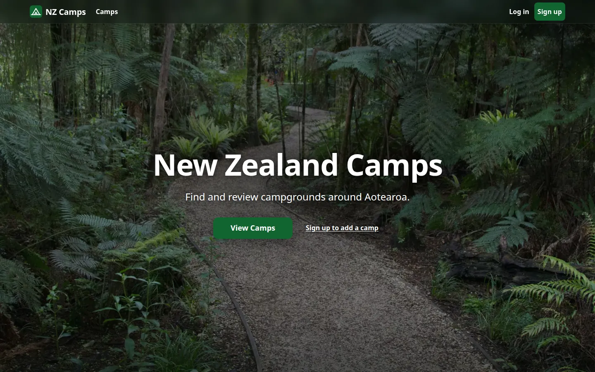
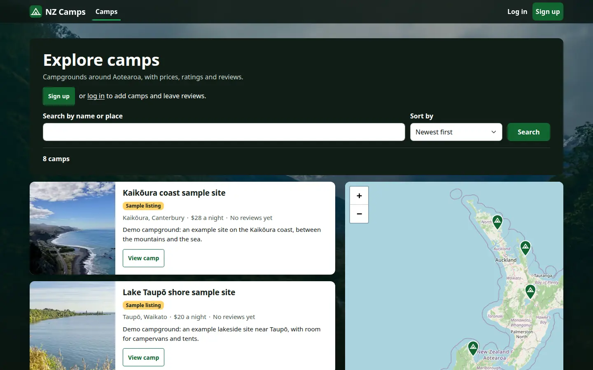
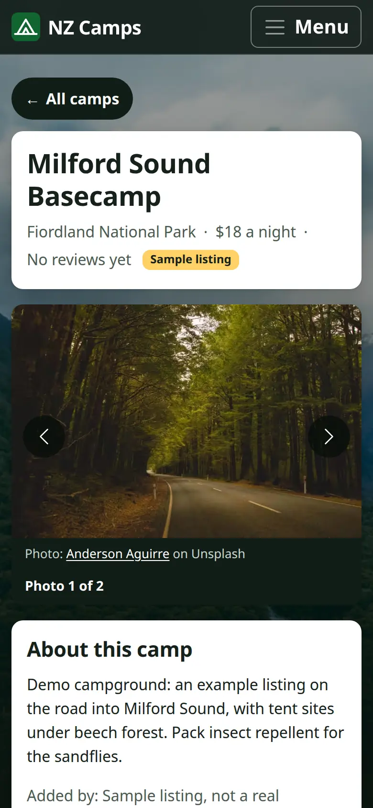

# NZ Camps

A campground directory and review site for New Zealand, built with Node.js, Express, EJS and MongoDB.

**Live demo:** [nz-camps.vercel.app](https://nz-camps.vercel.app/)



<p>
  
  
</p>

## What it is

Visitors can browse campgrounds on a clustered map of New Zealand and read reviews. Signed-in users can add their own camps with photos and a location, edit or delete the camps they created, and leave star-rated reviews on any camp.

I started it in July 2021 as a learning project, originally using Mapbox for maps and geocoding and hosted on Heroku. In January 2025 the maps moved to Leaflet with OpenStreetMap tiles and geocoding moved to OpenCage. In June 2026 I upgraded it to Mongoose 8 and redeployed it as a serverless function on Vercel. In October 2026 I went through it again: I fixed the security problems a code review found (personal data in the page source, stored script injection through camp text, session and upload handling), labelled the sample listings, rebuilt the pages for phones, keyboards and screen readers, and added the automated tests described below.

## Features

- **Accounts:** register, log in and log out with Passport 0.7 (local strategy, via `passport-local-mongoose`). Failed logins slow down with a back-off stored on the account. When a database is connected, sessions are stored in MongoDB with `connect-mongo` on Mongoose's own connection; anonymous visits store no session.
- **Camps:** create, edit and delete campgrounds (title, price per night, location, description, photos). Only the camp's creator can edit or delete it.
- **Photo uploads:** up to three JPG, PNG or WebP photos of up to 1.4 MB each per form (six per camp), checked by their content, not the declared type. In the browser, photos larger than 1600 px or 1.4 MB are shrunk before they are sent, which also drops their location and camera details; the server strips that metadata from JPEGs sent without the script. With Cloudinary credentials set, uploads go to Cloudinary, and only after the rest of the form has passed its checks. Without them, images are stored in the camp document as data URIs, so uploads still work on serverless hosting with no writable disk. The edit form can add more photos or remove existing ones.
- **Geocoding:** the location text is turned into coordinates, with ", New Zealand" added to the search. Uses OpenCage when a token is set, otherwise the keyless OpenStreetMap Nominatim API; both are restricted to New Zealand results and give up after 5 seconds.
- **Maps:** the camps page shows every matching camp on a Leaflet map with marker clustering, fitted to the markers; on desktop the map sits beside the list, on phones a List | Map toggle swaps them. Each camp page has its own map with a marker.
- **Reviews:** 1 to 5 star ratings with a written review. Reviewers can delete their own reviews, and deleting a camp removes its reviews.
- **Validation:** Joi schemas (and matching Mongoose limits) check camp, review and sign-up input on the server; a form that fails comes back with what was typed and a list of problems. The browser runs the same checks first with the same messages, and `express-mongo-sanitize` strips MongoDB operators from request data.
- **Security:** a strict content security policy (no inline scripts or styles, front-end libraries served from this site), a cross-site form check, `HttpOnly`/`SameSite`/`Secure` session cookies and POST-only logout. Page data for the maps is written as escaped JSON and map popups are built from text, never HTML.
- **Sample listings:** eight invented camps at real places across both islands, labelled "Sample listing" wherever they appear; every page footer explains the label. Their photos are from Unsplash, each of the area it is listed in, with alt text and a credit line ([public/images/CREDITS.md](public/images/CREDITS.md)). There are no sample reviews.
- **Pages and photos:** responsive from 320 px wide, with one design system on Bootstrap 5.3 (`public/stylesheets/tokens.css`). Photos are served as AVIF (with JPEG fallbacks) at the width each slot needs, made by `npm run images`; the home page loads 173 KB of images on a phone instead of a 4.8 MB photo. Every page has its own title, description and social card image, a skip link, a visible focus ring on every control, buttons and controls at least 44 px, and no motion when reduced motion is set.
- **Demo mode:** if `DB_URL` is not set, or the database cannot be reached within 5 seconds, the camps list (with search, sort and pages) and the eight sample camp pages render from `seeds/demoData.js`, every page shows a banner saying so, and form submissions get a page explaining that nothing can be saved. After a failed connection the app tries again on a later request, at most once every 30 seconds, so one cold-start blip does not leave an instance on sample content.

## Tech stack

- Node.js 22, Express 4
- EJS with `ejs-mate` layouts, Bootstrap 5.3
- MongoDB (Atlas) with Mongoose 8
- Passport 0.7, `express-session`, `connect-mongo`, `connect-flash`
- Multer 2, Cloudinary 2
- Leaflet 1.9, Leaflet.markercluster, OpenStreetMap tiles
- OpenCage or Nominatim for geocoding
- Joi, Helmet, `express-mongo-sanitize`, `method-override`
- Vercel (one serverless function)
- Tests: Node's test runner, Supertest and an in-memory MongoDB; Playwright and axe-core in Chrome; ESLint and Prettier

## Running it locally

Use Node.js 22, the version set in `engines` in `package.json`.

```bash
npm install
npm start
```

Then open http://localhost:3000. With no database configured it starts in demo mode.

When `NODE_ENV` is not `production`, settings are read from a `.env` file in the project root with Node's built-in loader (variables already set win). `.env.example` lists every variable with a placeholder; copy it with `cp .env.example .env`. The app reads:

| Variable | Purpose |
| --- | --- |
| `DB_URL` | MongoDB connection string. Without it the app runs in demo mode. |
| `SECRET` | Session signing secret. If it is missing in production the app logs an error on every cold start and uses a server-side fallback, so always set it. |
| `OPENCAGE_ACCESS_TOKEN` | Optional. Use OpenCage for geocoding instead of Nominatim. |
| `CLOUDINARY_NAME`, `CLOUDINARY_API_KEY`, `CLOUDINARY_SECRET` | Optional. All three are needed to store uploads on Cloudinary. |
| `BASE_URL` | Optional public address, used only for absolute URLs (the canonical link). Navigation links are always relative. |
| `PORT` | Port to listen on. Defaults to 3000. |
| `NODE_ENV` | When not `production`, `.env` is loaded and error pages show stack traces. |

### Seeding the database

`seeds/seedAtlas.js` copies the eight sample camps into a database, labelled as samples. It skips any camp whose title already exists, and creates a `ranger` user as the author if there isn't one. The script does not load `.env`, so pass the variables on the command line. A database that is not on your machine also needs `CONFIRM_REMOTE=yes`:

```bash
DB_URL=mongodb://127.0.0.1:27017/nzcamps node seeds/seedAtlas.js
```

Set `SEED_PASSWORD` to choose the `ranger` user's password; otherwise a random one is generated and printed once.

`seeds/labelDemo.js` flags camps added by `ranger` in an existing database as samples (`isDemo`), and with `--photos` gives the sample camps the current credited photos. It is a dry run unless you add `--apply`, has the same `CONFIRM_REMOTE` guard, and prints only counts and a masked host:

```bash
DB_URL=mongodb://127.0.0.1:27017/nzcamps node seeds/labelDemo.js --photos          # dry run
DB_URL=mongodb://127.0.0.1:27017/nzcamps node seeds/labelDemo.js --photos --apply
```

### Tests and checks

```bash
npm test               # integration tests against an in-memory MongoDB (no network)
npm run test:coverage  # the same, with a line and branch coverage table
npm run test:e2e       # end-to-end and accessibility tests in Chrome (Playwright)
npm run lint           # ESLint
npm run format:check   # Prettier
npm run check:bundle   # trace the Vercel function and run the tests against that copy
npm run vendor         # re-copy the pinned Leaflet and Bootstrap files into public/vendor
npm run images         # remake the AVIF and JPEG photo variants (needs ImageMagick with AVIF)
```

**`npm test`** runs about 250 tests in `test/*.test.js` with Node's built-in runner and Supertest, each file against its own in-memory MongoDB (`mongodb-memory-server`, pinned to MongoDB 8.2.6 in `package.json`; the binary is fetched on first use and cached in `~/.cache/mongodb-binaries`, never at install time). A guard in `test/helpers/guard.js` makes any request that leaves the machine fail, so the geocoder, Cloudinary and real databases are never reached, and an unhandled rejection fails the run. They cover accounts and sessions, camp and review create, edit and delete with ownership checks, search, sort and pages, uploads, demo mode and reconnecting, the seed scripts, error pages, the page markup the design relies on, and `test/security.test.js`, where each test is named after the hole it guards (personal data in pages, stored script injection, photo ownership, cookies and sessions, cross-site form posts, security headers, upload types, operator-shaped form input). Line coverage is 98.9% overall: 100% for the controllers, middleware, routes and schemas, and at least 91% for every file in `utils/`.

**`npm run test:e2e`** runs the specs in `e2e/` with Playwright, at 390 px (a phone) and 1440 px. It starts two local servers by itself (`e2e/server.js`: one on an in-memory MongoDB with the sample camps and a few test camps, on port 7203, and one in demo mode on 7206) and stops them at the end. It uses Chrome at `/usr/bin/google-chrome`, or the browser in `CHROME_PATH`; without either, install Playwright's Chromium once with `npx playwright install chromium`. Map tiles are answered with a local image, so the run needs no network and never loads the public tile servers.

- `journey.spec.js`: home to the list with every camp on the map, search, page 2, and a member's journey: sign up, add a camp with a large photo (shrunk to 1600 px in the browser), review it, move it and see the pin move, add and remove photos, delete the review and the camp, log out.
- `security.spec.js`: a camp whose name, place, description and review are script-shaped stays plain text on the list, its own page and both map popups.
- `demo.spec.js`: demo mode shows the banner and the eight sample camps, and a log in gets a plain "can't be saved" page.
- `a11y.spec.js`: axe-core's WCAG 2.0, 2.1 and 2.2 A and AA rule sets on 20 page states (signed in and out, forms with errors, 404, demo mode) must find nothing; every control is at least 44 x 44 px; nothing scrolls sideways at 320 px; the maps and the photo carousel do not animate with reduced motion.
- `keyboard.spec.js`: the main journey with the keyboard alone, and a Tab pass over eight pages checking that every control shows the focus outline.
- `guard.spec.js`: every page in every spec is watched for console errors, script errors, content security policy violations, failed requests and sideways scrolling; this spec causes each of those on purpose to prove they are caught.

Results go to `test-results/` (not committed): failure traces and screenshots, and the accessibility results as JSON in `test-results/a11y/`.

## Deployment

`vercel.json` rewrites every request to `api/index.js`, which exports the Express app from `index.js`. `index.js` only calls `app.listen` when run directly, so the same code serves both `npm start` and Vercel. On a cold start, requests wait for the MongoDB connection (up to 5 seconds) before falling back to demo content; a failed connection is retried on the request path (no timers, since a frozen function runs none) at most every 30 seconds. Photos stored as data URIs (when Cloudinary is not set up) are served from their own address, `/camps/<id>/images/<photo id>`, with a long cache lifetime, instead of being written into the pages. Three photos of up to 1.4 MB keep a form under Vercel's 4.5 MB request body limit. The function bundle holds the traced code plus `views/`; `public/` is served by Vercel's CDN, and `public/vendor/` is cached for a year.

## Project structure

```
index.js          Express app: sessions, auth, demo mode, routes, error handling
api/index.js      Vercel entry point (re-exports the app)
routes/           camps, reviews and user routes
controllers/      route handlers
models/           Camp, Review and User (Mongoose)
middleware.js     login, ownership and validation checks
schemas.js        Joi validation schemas
cloudinary/       photo uploads: limits, content checks, Cloudinary or data URIs
utils/            geocoding, sessions, security headers, view helpers, errors
seeds/            sample camps and the database seeder
views/            EJS templates
public/           stylesheets, images, browser scripts and vendored libraries
scripts/          bundle check, vendoring and image scripts
test/             integration tests and their helpers
e2e/              Playwright specs, their local server and fixtures
playwright.config.js  browsers, widths and the two local test servers
docs/             README screenshots
.env.example      every environment variable, with placeholders
```

All photos are from Unsplash; [public/images/CREDITS.md](public/images/CREDITS.md) and the site's own /credits page list each photographer, its Unsplash page and the location that page gives.

## Author

Built by Daniel Olliver. More of my work: [danielolliver.com/dev](https://danielolliver.com/dev/).

I also run [Olliver Web](https://olliverweb.co.nz), a web design and development studio in Auckland.
